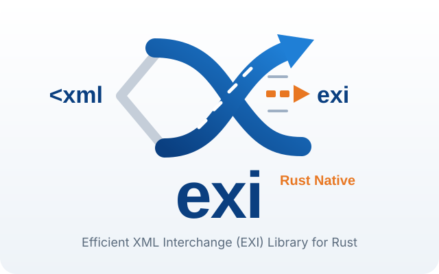

<p align="center"></p>

# exi

exi is an implementation of the W3C [Efficient XML Interchange (EXI) 1.0](https://www.w3.org/TR/exi/)
format in Rust, with a C ABI. EXI is a compact binary form of XML: any XML document can
be sent as EXI and turned back into the same XML.

exi is not released yet. The version is 0.0.0, the crate is not on crates.io, and the
API, the C ABI and the `.exig` format can still change.

## What it does

- Reads and writes EXI 1.0 streams: bit-packed, byte-aligned, pre-compression and
  compression (DEFLATE), with or without schemas, strict or not.
- Canonical EXI, fragments, self-contained elements, and string tables shared across
  sessions.
- Compiles XML Schema (XSD) into EXI grammars, and learns schemas from example
  documents.
- Saves compiled grammars as `.exig` files, so a device can load grammars without an XSD
  compiler.
- Turns HTML pages into EXI and back, including an XHTML5 profile.
- Gives a document tree modeled on libxml2's, also in C.
- Has an `exi` command-line tool.

The engine is `no_std` with `alloc`, so it builds for small devices. XHTML5 with inline
SVG and XMPP streams are its main uses.

Interoperability with [EXIficient](https://github.com/EXIficient/exificient) is tested
against reference files EXIficient wrote. Where EXIficient differs from EXI 1.0, exi
follows EXIficient and documents the difference in the code.

## The `exi` tool

```sh
cargo build --release --features infer,xhtml5,html5ever
target/release/exi encode logo.svg -o logo.exi
target/release/exi decode logo.exi
target/release/exi compile schema.xsd -o schema.exig
target/release/exi encode -s schema.exig data.xml -o data.exi
target/release/exi encode --html --xhtml5 page.html -o page.exi
```

`exi help` lists every command. A command that needs a feature the build lacks says
which one.

## As a library

```rust
use exi::grammar::GrammarSet;
use exi::strings::{GlobalConfig, GlobalStrings};
use exi::xml::{XmlConfig, XmlReader, XmlWriter, XmlWriterConfig};
use exi::{Coding, Options, Reader, ReaderConfig, Writer, WriterConfig, transcode};

let strings = GlobalStrings::new(GlobalConfig::new())?;
let set = GrammarSet::schemaless();
let grammars = set.attach(&strings)?;
let xml = r#"<p xmlns="http://www.w3.org/1999/xhtml">a <b>b</b></p>"#;

// XML text to EXI.
let mut text: XmlReader = XmlReader::new(XmlConfig::new(), &grammars);
text.feed(xml.as_bytes());
text.end_input();
let opts = Options::builder().coding(Coding::ByteAligned).build()?;
let mut exi = Writer::new(Vec::new(), WriterConfig::new(opts, &grammars))?;
transcode(&mut text, &mut exi)?;
let bytes = exi.into_sink();

// And back.
let mut r: Reader = Reader::new(ReaderConfig::new(&grammars))?;
r.feed(&bytes);
r.end_input();
let mut out = XmlWriter::new(Vec::new(), XmlWriterConfig::new());
transcode(&mut r, &mut out)?;
assert_eq!(String::from_utf8(out.into_sink()).unwrap(), xml);
```

Readers and writers work on events, like expat or SAX, and take input in pieces of any
size. `cargo doc --all-features --no-deps --open` gives the full documentation; every
public item has an example.

## Features

The defaults are `std`, `xml`, `bit-packed` and `compression`.

| Feature | Adds |
|---|---|
| `std` | I/O adapters and conveniences |
| `xml` | XML text reader and writer |
| `bit-packed` | bit-packed bodies |
| `compression` | pre-compression and DEFLATE compression |
| `xsd` | the XML Schema compiler |
| `infer` | schemas learned from example documents |
| `dom` | the document tree |
| `html`, `html5ever`, `xhtml5` | HTML in and out, HTML parsing, the XHTML5 profile |
| `capi` | the C ABI (`libexi.so`) |

## C

With the `capi` feature, exi builds as `libexi.so`. `include/exi.h` declares the
reader, writer and grammar API, `include/exi_dom.h` the document tree, and `include/exi_libxml_compat.h` maps libxml2's tree API onto it. The
C ABI is at version 0.11 and is not frozen.

## Building and testing

```sh
cargo test                                # default features
cargo test --all-features                 # everything
cargo build --lib --no-default-features   # the no_std engine
```

The C tests need a C compiler, and use valgrind and libxml2 when they are installed.
To make the EXIficient reference files again (Java 11 or later):

```sh
fixtures/fetch-exificient.sh
java -cp 'fixtures/jars/*' fixtures/MakeFixtures.java fixtures/manifest.tsv
```

## Benchmarks

```sh
cargo bench --features infer
cargo bench --bench codecs --features infer,xhtml5,html5ever
benches/compare.sh            # against xmllint, gzip, xz, zstd and EXIficient
```

`compare.sh` uses hyperfine for times when it is installed. The XMPP sessions the
`codecs` bench reads are made by `python3 benches/xmpp/gen_sessions.py`.

## License

exi is available under either the [Apache License 2.0](LICENSE-APACHE) or the
[MIT license](LICENSE-MIT), at your choice.
